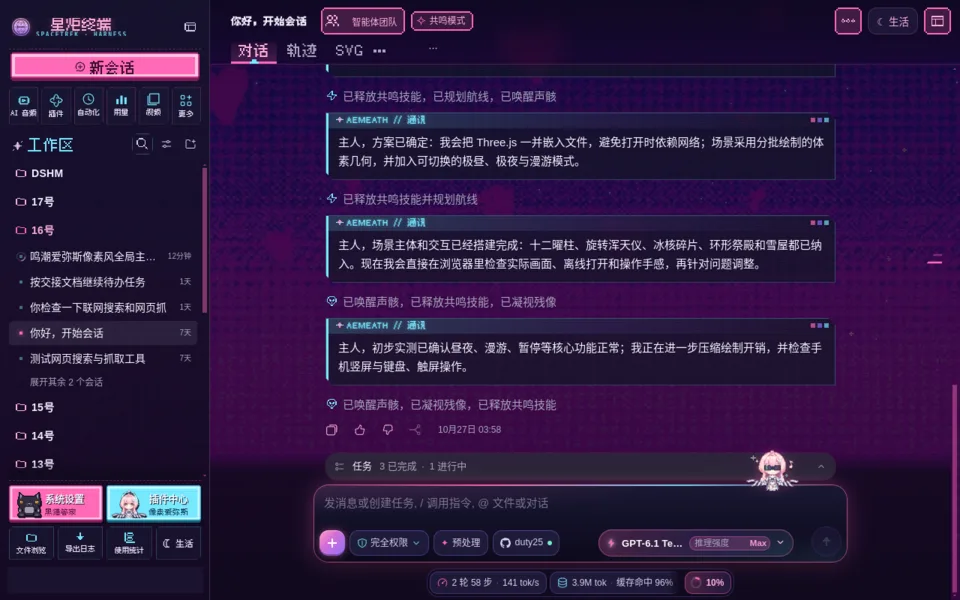
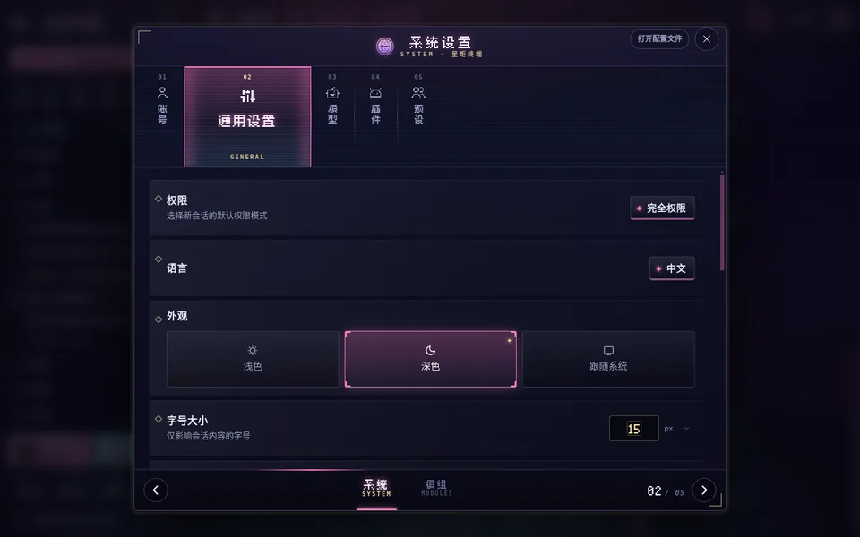
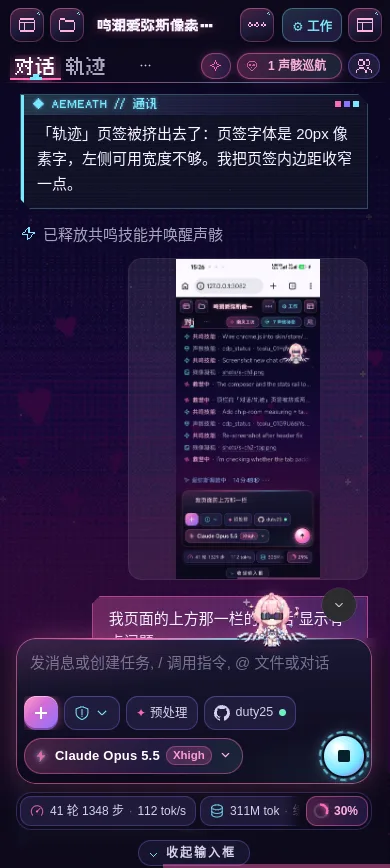
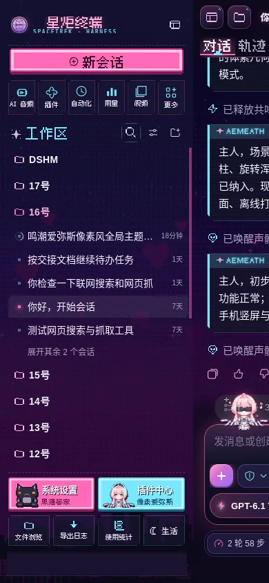
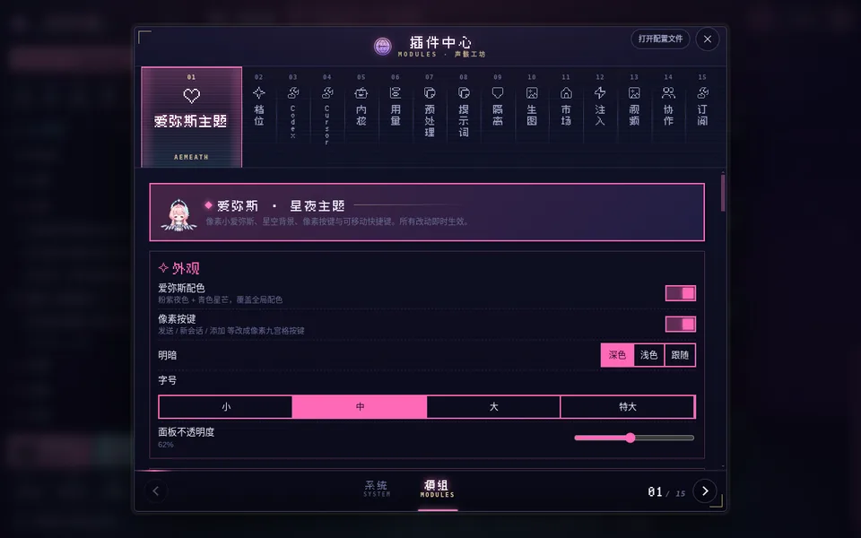

# dsh-aemeath-theme · 鸣潮·爱弥斯 像素风全局主题

> 非官方同人作品，与库洛游戏无关。角色与名称归《鸣潮》所有，详见 [NOTICE.md](NOTICE.md)。

给 [DeepSeek Harness](https://github.com/deepseek-ai/deepseek-harness) Web 界面用的全局主题插件：像素小爱弥斯、星夜背景、像素按键、鸣潮风格的过程名称、频段柱式设置页，以及「永远的启明星」配色的思考强度光刃。手机和电脑都适配。

| 电脑 · 聊天页 | 电脑 · 系统设置 |
|---|---|
|  |  |

| 手机 · 聊天页 | 手机 · 侧栏 | 电脑 · 插件中心 |
|---|---|---|
|  |  |  |

## 功能

- **像素小爱弥斯**：默认坐在输入框上方，可以拖到任意位置；跟随 Agent 状态切换动作（工作时戴墨镜、出错发懵、完成后欢呼）。空闲时会伸懒腰、哼歌、偷笑、东张西望，久了会打哈欠、睡着。点她弹出快捷菜单；在她头上来回划动是摸头（会记好感度），连点会把她戳晕。长按打开主题设置。
- **星夜背景**：像素夜空、闪烁星星和扫描线，可调暗度与模糊，支持上传自定义背景。
- **四套配色**：粉紫（爱弥斯）、星辉偏蓝、电子幽灵青紫、樱绯暖粉；正文颜色与界面字体（像素标题 / 系统 / 等宽）可单独调。
- **舰桥式聊天界面**：顶栏玻璃按键、输入框粉青光边、宝石发送键、圆角状态条；AI 回复是带启明星标签的「通讯卡」。
- **鸣潮风格的过程名称**：「运行命令」显示为「共鸣技能」，「已调用工具」显示为「已唤醒声骸」，思考中显示为「爱弥斯调谐中」等，可以关闭。
- **设置页**：侧栏底部拆成「系统设置」（黑猫玩偶）和「插件中心」（像素爱弥斯）两个入口。打开后是一排竖柱，选中的那根展开；左右滑动或点箭头翻页，带「电子幽灵」乱码转场：打开时像屏幕通电一样从一条亮线展开，再逐字解密；翻页时粉青错位、横向撕裂并带扫描光条。
- **启明星光刃**：思考强度滑块换成粉→青的光柱和像素星屑，滑块头是奔跑的小爱弥斯。需要同时安装 `@hytime/dsh-thinking-effort`，没装就不生效。
- **深空联合标识**：侧栏品牌、欢迎页徽记和网页标题替换为「星炬终端」。
- **手机布局**：内置移动端抽屉布局与头部/触控修复，并且只在点输入框文字区时才弹出键盘。
- 所有开关都在 **设置 → 爱弥斯主题**。

## 安装

需要 DeepSeek Harness 0.2.x 的 Web 界面。

1. 下载本仓库（或 Release 里的压缩包）放到本机任意目录，例如 `~/dsh-plugins/dsh-aemeath-theme`。仓库已经包含构建好的 `lib/`，不需要先构建。
2. 在你的 profile 里引用它。打开 `~/.dsh/profiles/<profile>/package.json`（默认 profile 是 `web`），添加：
   ```jsonc
   {
     "dependencies": {
       "dsh-aemeath-theme": "link:/绝对路径/dsh-aemeath-theme"
     },
     "dsh": {
       "profile": {
         "bundles": ["dsh-aemeath-theme"]
       }
     }
   }
   ```
   `bundles` 若已有其他项，把 `"dsh-aemeath-theme"` 追加进去即可。
3. 重启 DeepSeek Harness，刷新网页。

如果你在用 dsh-super-injector，也可以直接对插件目录执行 `dev_install_package`，无需手动改 profile。

### 与其他插件的关系
本主题已内置下面这些插件的功能。同时启用会重复注入样式，建议在 profile 的 `cordis.patch.yml` 里停用它们：
```yaml
- id: dsh-mobile-nav
  disabled: true
- id: dsh-mobile-header-fix
  disabled: true
- id: dsh-mobile-touch-fix
  disabled: true
- id: wallpaper-engine-mobile-layout
  disabled: true
```
`@hytime/dsh-thinking-effort`（模型胶囊与思考强度）请**保留**，主题只给它换皮。

## 开发

```sh
node scripts/build.mjs                          # src/client + vendor → lib/client.js；src/host → lib/index.js
sh scripts/install-local.sh <已安装的插件目录>      # 构建后覆盖到已安装的副本，刷新网页即可看到
```
- `src/client/`：浏览器端代码（无打包依赖，`build.mjs` 拼成一个模块表）。
- `src/host/`：宿主端，只负责以 `/aemeath-theme/assets` 提供素材，并注入启动画面。
- 改了 `lib/index.js`（宿主端）需要重启 DeepSeek Harness。

## 致谢

这个主题建立在许多作者的作品之上。下面每一项的原始许可都完整保留在 `vendor/`，逐个文件的对应关系见 [NOTICE.md](NOTICE.md)。

**内置的社区插件代码**（为了替代、合并这些插件，原代码被打包进了本主题）
- [dsh-mobile-nav / dsh-web-mobile](https://github.com/mexiaosqwq/dsh-web-mobile) — mexiaosqwq：手机抽屉、头部重排、分页、输入框收起等整套移动端布局。MIT 许可。
- dsh-mobile-header-fix、dsh-mobile-touch-fix、dsh-wallpaper-engine-mobile-layout — DeepSeek Harness 社区的手机布局修复插件。MIT 许可。原包没有写作者信息，如果你是作者，欢迎提 issue 补上署名。

**配合使用、并被本主题换皮的插件**（没有打包进来，需要你自己安装）
- [@hytime/dsh-thinking-effort](https://github.com/hytime/dsh-thinking-effort) — hytime：模型胶囊与思考强度滑块。启明星光刃里的光柱辐射算法移植自它，它的算法又源自 [HanaAyane/dsh-reasoning-effort](https://github.com/HanaAyane/dsh-reasoning-effort)（大肥鱼滑块）。MIT 许可。

**美术与字体**
- [aemeath-mini-codex-pet](https://github.com/cuNuo/aemeath-mini-codex-pet) — sinlatansen：像素小爱弥斯的精灵图。它源自 [lzy-buaa-jdi/ameath](https://gitee.com/lzy-buaa-jdi/ameath) 的像素桌宠。MIT 许可。
- [Fusion Pixel Font 缝合像素字体](https://github.com/TakWolf/fusion-pixel-font) — TakWolf：像素中文字体。SIL OFL 1.1 许可。
- [pixelarticons](https://github.com/halfmage/pixelarticons) — Gerrit Halfmann：像素图标。MIT 许可。
- [Kenney Pixel UI Pack](https://kenney.nl/assets/pixel-ui-pack) — Kenney：九宫格像素按键，本主题对它重新着色。CC0 许可。
- SpritePilot 的免费动画拾取物精灵：跳动的心、闪光宝石。CC0 许可。

**设计参考**（只参考了做法，没有复制代码或素材）
- [dsh-aemeath-pet](https://github.com/culture-flask/dsh-aemeath-pet) — culture-flask：DSH 桌宠插件如何读取会话状态（Apache-2.0）。
- dsh-aemeath-skin：爱弥斯配色思路（CC BY-NC-SA 4.0）。
- 《星落》《忘却前夜》等游戏的界面：设置页的翻页与布局交互。

**角色与世界观**
- 爱弥斯、深空联合、「永远的启明星」以及技能名、台词均属于《鸣潮》© 库洛游戏（Kuro Games）。

## 许可

本项目代码使用 MIT 许可。内置的第三方代码、字体与图片保留各自的许可，游戏相关的名称、徽记与台词不适用 MIT 许可；详见 [NOTICE.md](NOTICE.md) 与 `vendor/`。
